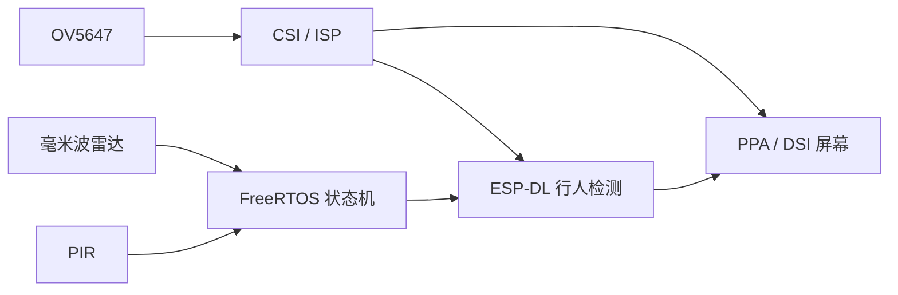

# ESP32-P4 三模态行人入侵检测

基于 Waveshare ESP32-P4-WIFI6 的学习项目。使用毫米波雷达、PIR 和 OV5647 摄像头采集信息，在 10.1 英寸 DSI 屏上显示画面，并用 ESP-DL 行人检测模型绘制检测结果。项目仍在硬件联调阶段，尚不是可独立报警、联网的完整装置。

## 当前进度

| 模块 | 当前代码状态 |
| --- | --- |
| 雷达与 PIR | GPIO 输入、雷达上升沿中断及 FreeRTOS 状态机已接入 |
| 摄像头与显示 | OV5647、MIPI CSI、ISP、PPA、JD9365 DSI 显示链路已写入工程；实际运行效果仍需结合硬件验证 |
| 行人检测 | 已接入 `pedestrian_detect`，可在画面上绘制检测框和置信度；识别准确性仍需实测 |
| 报警与上传 | 蜂鸣器/LED、ESP32-C6 Wi-Fi、事件与图片上传尚未实现 |

目前的状态机负责雷达触发、PIR 检查和冷却循环。视觉任务的启停逻辑仍在调试，不能把现有代码当成“只有三种传感器都确认后才报警”的成品逻辑。



## 硬件与环境

- 开发板：Waveshare ESP32-P4-WIFI6，项目配置按 ESP32-P4 rev v1.x、32 MB Flash 和 32 MB PSRAM 编写。
- 摄像头：OV5647，MIPI CSI 双通道；当前代码选择 800 × 800 RAW8 模式。
- 显示屏：Waveshare 10.1-DSI-TOUCH-A，JD9365，800 × 1280。
- 传感器：E54-24LD12C 毫米波雷达、AM312 PIR。
- 开发环境：ESP-IDF v6.0.1；依赖由 ESP-IDF Component Manager 根据 `components/vision/idf_component.yml` 和 `dependencies.lock` 获取。

雷达目前使用 GPIO15，PIR 使用 GPIO16。这两个引脚同时属于板上 ESP32-P4 与 ESP32-C6 之间的 SDIO 接口；接入 Wi-Fi 前必须重新分配传感器引脚，并核对实际接线与电平。

## 获取与构建

在已安装并激活 ESP-IDF v6.0.1 的终端中执行：

```sh
git clone https://github.com/3280441136-lab/AIVisualWatcher-ESP32P4.git
cd AIVisualWatcher-ESP32P4
idf.py set-target esp32p4
idf.py build
```

构建前请注意：目前使用的 Waveshare `esp_lcd_jd9365_10_1` 组件与 ESP-IDF v6.0.1 有 API 字段差异。本地开发环境曾在忽略的 `managed_components/waveshare__esp_lcd_jd9365_10_1` 中做兼容修改，包括将 `color_space` 改为 `rgb_ele_order`、用 `in_color_format` / `out_color_format` 替代 `pixel_format`，以及移除 `flags.use_dma2d`。这些修改未包含在仓库中，依赖重新下载后可能需要重新适配；因此不能保证全新克隆后直接编译通过。

`sdkconfig`、`build/` 和 `managed_components/` 是本地生成内容，不纳入版本控制。默认配置保存在 `sdkconfig.defaults`，分区表保存在 `partitions.csv`。

## 目录

```text
main/                 应用初始化入口
components/app_fsm/   雷达与 PIR 状态机
components/radar/     雷达 GPIO 与中断
components/pir/       PIR GPIO 读取
components/vision/    摄像头、显示、PPA 与行人检测
doc/                  硬件资料、需求与学习记录
```

硬件接线、当前限制和后续计划见 [`doc/硬件资源与驱动信息.md`](doc/硬件资源与驱动信息.md) 与 [`doc/学习进度与搁置问题.md`](doc/学习进度与搁置问题.md)。这些记录形成于不同开发阶段，具体实现以当前源码为准。
